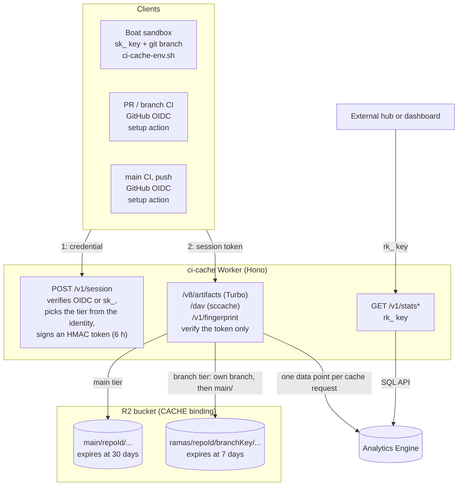
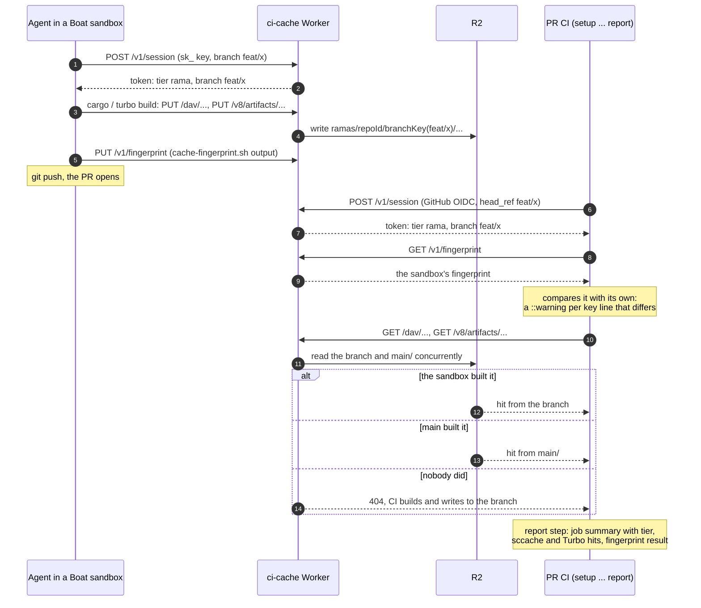
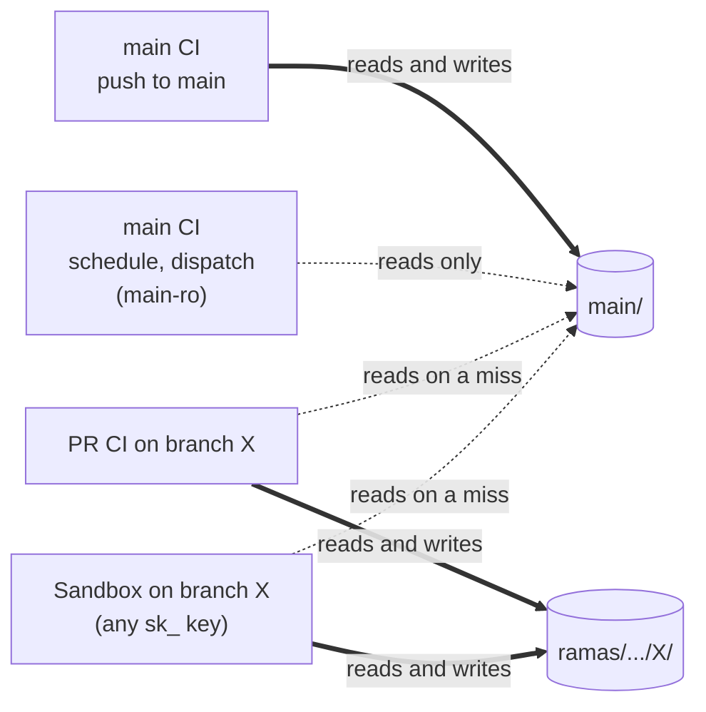

# ci-cache

A CI cache engine on Cloudflare R2: one Worker that stores the **Turbo** cache (Remote Cache
API v8) and the **sccache** cache (WebDAV backend) per repository, with a `main/` tier that
only CI on `main` writes and a per-branch tier that both the agent in its Boat sandbox and
that branch's CI write.

The point: an agent's build in its sandbox warms its own PR's CI, and nothing an agent (or
a PR) writes can ever reach `main/`. A pinned composite action wires GitHub Actions, and a
shell script wires sandboxes.

No dashboard: metrics come out of a JSON API documented in [`openapi.yaml`](openapi.yaml)
(OpenAPI 3.1), so any frontend can use it ([why](#why-there-is-no-dashboard)).

## Quickstart

1. **Deploy the Worker** (one R2 bucket, two lifecycle rules, a few secrets) with one
   command: `bash scripts/bootstrap.sh --allowed-owners <your-user-or-org>`
   ([Deploying](#deploying-with-wrangler)). Save the URL it prints as the GitHub Actions
   **secret** `CI_CACHE_URL`.
2. **CI.** Give the job `id-token: write` and add the action early in the job:

   ```yaml
   jobs:
     build:
       runs-on: ubuntu-latest
       permissions:
         contents: read
         id-token: write           # for the GitHub OIDC token
       steps:
         - uses: actions/checkout@v5
         - id: cache
           continue-on-error: true # a cache problem is a slower run, never a red one
           uses: OmarAlex24/ci-cache/setup@<sha>
           with:
             url: ${{ secrets.CI_CACHE_URL }}   # a secret: GitHub masks it in logs
         - run: pnpm turbo run build   # and/or cargo build: both now go through the Worker
           working-directory: ${{ steps.cache.outputs.workdir || github.workspace }}
         - if: always()                # last step: hits, misses and the fingerprint check
           continue-on-error: true
           uses: OmarAlex24/ci-cache/report@<sha>
   ```
3. **Sandboxes** (optional). Mint a sandbox key, add its hash to `SANDBOX_KEYS`, put the
   key in the sandbox as `CI_CACHE_SANDBOX_KEY`, then run
   `bash scripts/ci-cache-env.sh && source ~/.ci-cache.env` before building:
   [Boat sandbox](#boat-sandbox-scriptsci-cache-envsh).
4. **Check it hits**: the report step's table in the job summary (sccache hit rate, Turbo
   tasks from cache, the sandbox vs CI fingerprint check), any `ci-cache cache key
   mismatch` warning, and `GET /v1/stats/branches` ([Metrics](#metrics)).

Agents working on this repo, or connecting another repo to it, start at
[`AGENTS.md`](AGENTS.md). The [`skill/ci-cache`](skill/ci-cache) Claude Code skill automates
onboarding a repo (audit, keys, CI and sandbox wiring, measurement).

## Supported technologies

Derived from the code and the e2e suites (`pnpm e2e`). "Tested (e2e)" means a real client
runs against `wrangler dev` in `scripts/e2e/`.

| Technology | Status | Notes |
| --- | --- | --- |
| Turbo (TS/JS monorepos) | Tested (e2e) | Remote Cache API v8 at `/v8/artifacts`; e2e with turbo 2.11.10 |
| Rust via sccache | Tested (e2e) | sccache 0.19.0, WebDAV at `/dav/`; e2e with `cargo build` on a two-crate workspace. The action installs sccache by SHA-256 on Linux x86_64 and aarch64 (both pinned); the e2e runs that install in Docker (ubuntu:24.04) on the host's architecture only |
| C/C++ via sccache | Should work, untested | Nothing in `/dav/` is Rust-specific. But `sccache: auto` only detects a `Cargo.toml` and the action only exports `RUSTC_WRAPPER`: set `sccache: "true"` and your own launcher (`CMAKE_C_COMPILER_LAUNCHER=sccache`, `CC="sccache gcc"`, …) |
| Docker / BuildKit layers | Not served by ci-cache | The skill recommends BuildKit `type=gha` (the Actions cache); ci-cache has no Docker credentials or registry API |
| Nx, Bazel, Gradle | Not served by ci-cache | Not supported: their remote cache protocols are not implemented ([adding support](#adding-support-for-your-stack)) |
| GitHub Actions | Tested (e2e) | Sessions from GitHub OIDC. `setup/setup.sh` is tested with a fake OIDC endpoint (the real one only exists inside Actions). Linux runners; the sccache install and `mount-workdir` are Linux-only (`mount-workdir: auto` skips the mount elsewhere), so a macOS runner can use Turbo only (`sccache: "false"`, should work, untested) |
| Boat sandboxes | Tested (e2e) | `scripts/ci-cache-env.sh` with an `sk_` key against `wrangler dev`. Any environment that can run a bash script with an `sk_` key should work the same way (untested) |
| Other CI providers (GitLab, CircleCI, Buildkite, …) | Not served by ci-cache | Not supported: only GitHub's OIDC issuer is accepted. An `sk_` key would work technically, but always gets the branch tier, so it could never fill `main/` |

### Package managers

ci-cache caches **task and compile outputs, not installs**: it never sees `node_modules`, a
pnpm store or `~/.cargo/registry`. Package managers matter only through the tool on top:

- **Through Turbo**: npm is tested (the e2e fixture is an npm workspace, `npm@10.9.2`).
  pnpm, yarn and bun should work, untested: Turbo hashes their lockfiles and ci-cache only
  stores the resulting artifacts. This repo itself uses pnpm for its own development.
- **Through sccache**: cargo is tested.
- Install caches stay where they are (`setup-node`'s cache, `Swatinem/rust-cache` for
  `~/.cargo`). Under `mount-workdir` pnpm can't hard-link from a store restored on the other
  side of the bind mount (EXDEV); `skill/ci-cache/references/turbo.md` has the options.

## Architecture



Every request without a valid credential counts against a per-IP rate limit; valid tokens
never do ([Rate limit](#rate-limit-on-bad-credentials)). Each cache request only verifies the
session token's HMAC signature: no database, no R2 keys in the Worker (it uses the `CACHE`
binding).

### A pull request, end to end



- `repoId` is the numeric GitHub repo id (it doesn't change on a rename).
- `branchKey` is the first 16 hex characters of `sha256(branch name)`.
- The tier comes first in the key, so expiry is **2 R2 rules for every repo**.
- The branch tier's wire value is `rama` and its R2 prefix is `ramas/` (with the lifecycle
  rule `ramas-7d`). These are fixed identifiers of the API and the bucket layout; renaming
  them would orphan existing objects and break clients.

## Tiers, and why they prevent poisoning

The client **never picks its tier**: it follows from who the client is.



Nothing on a branch can write to `main/`: only a push to main (an OIDC token signed by
GitHub) does.

| Identity | Tier | Reads | Writes |
| --- | --- | --- | --- |
| OIDC, an event in `MAIN_WRITE_EVENTS` (default `push`) on a ref in `MAIN_REFS` | `main` | `main/` | `main/` |
| OIDC with `head_ref` (pull_request, pull_request_target) | `rama` (branch) = `head_ref` | its branch, then `main/` | its branch |
| OIDC, another event on a main ref (schedule, workflow_dispatch...) | `main-ro` | `main/` | nothing (403) |
| OIDC on any other ref (push to a branch, tags) | `rama` (branch) = the ref name | its branch, then `main/` | its branch |
| Sandbox key `sk_...` | **always** `rama` (branch), even if the branch is named `main` | its branch, then `main/` | its branch |

Rules are evaluated in that order: `head_ref` is checked before "main ref" because
`pull_request_target` carries `ref = refs/heads/main` (the base branch) and must land in the
branch tier.

**Why there is no poisoning:** the only thing `main` CI reads is `main/`, and only `main`
CI itself (a push, with an OIDC token signed by GitHub) writes to `main/`. If an agent in a
sandbox produces a bad artifact — through a bug, a different environment or on purpose — it
stays in `ramas/<repoId>/<branchKey>/` and at most that same branch's CI reuses it. It never
reaches `main/`, so neither `main` nor any other branch ever reuses it. A stolen sandbox key
can only write to branches, which expire in 7 days.

## Endpoints

Full detail in [`openapi.yaml`](openapi.yaml).

| Endpoint | Credential | What it does |
| --- | --- | --- |
| `GET /health` | none | liveness check |
| `POST /v1/session` | OIDC or `sk_...` | issues the session token |
| `GET /v8/artifacts/status` | session | `{"status":"enabled"}` |
| `GET`/`HEAD`/`PUT /v8/artifacts/{hash}` | session | Turbo artifacts |
| `POST /v8/artifacts` | session | batch lookup |
| `POST /v8/artifacts/events` | session | turbo events (validated and dropped) |
| `GET`/`PUT`/`PROPFIND /dav/...` | session | WebDAV for sccache |
| `PUT`/`GET /v1/fingerprint` | session | stores the session's cache fingerprint / returns the one to compare against ([Fingerprints](#sandbox-vs-ci-fingerprints)) |
| `GET /v1/stats?repo=&range=` | `rk_...` | hits, misses, bytes, time saved, by tier, kind and protocol |
| `GET /v1/stats/branches?repo=&range=` | `rk_...` | reuse per branch and `reuseAlert` |
| `GET /v1/stats/repos?range=` | `rk_...` | the repos with traffic: name, totals, `lastSeenAt` and how many branches have `reuseAlert` |

## sccache (WebDAV)

Tested with **sccache 0.19.0** (OpenDAL's `webdav` backend) against `wrangler dev`. With
`SCCACHE_WEBDAV_ENDPOINT=https://<your-worker>/dav` and
`SCCACHE_WEBDAV_TOKEN=<session token>`, sccache only uses these verbs, and they are the only
ones the Worker implements:

| Verb | Path | When |
| --- | --- | --- |
| `GET` | `/dav/.sccache_check` | at server start, to check reads |
| `PROPFIND` (`Depth: 0`) | `/dav/` and `/dav/<a>/<b>/<c>/` | before each write, to know whether the parent directory exists; requires `getlastmodified` in the response |
| `PUT` | `/dav/.sccache_check` | at start, to check writes (a 403 leaves sccache read-only) |
| `GET` | `/dav/<a>/<b>/<c>/<hash>` | look up a compiled object |
| `PUT` | `/dav/<a>/<b>/<c>/<hash>` | store a compiled object |

`MKCOL` only shows up if `PROPFIND` says the directory doesn't exist; since R2 has no
directories, the Worker answers that they all exist and sccache never sends it. With
`SCCACHE_WEBDAV_DISABLE_CREATE_DIR=true` (the action and `ci-cache-env.sh` export it)
sccache doesn't send the `PROPFIND` either: each write is a single `PUT`. Any other verb
gets 405, and `PROPFIND` with a `Depth` other than 0 gets 403 (there are no listings). If
the endpoint ends in `/`, sccache sends `/dav//...`; the Worker tolerates it.

For sccache to hit between sandbox and CI, the checkout path, the toolchain and the flags
must match (see `scripts/cache-fingerprint.sh`), and `CARGO_INCREMENTAL=0` (sccache doesn't
cache incremental compilations). The action checks this on its own:
[Sandbox vs CI fingerprints](#sandbox-vs-ci-fingerprints).

## Sandbox vs CI fingerprints

If a sandbox and its branch's CI compile with different keys (another `RUSTFLAGS`,
toolchain, checkout path, user, `CARGO_HOME`…), CI misses everything the sandbox built.
ci-cache compares them automatically:

1. `ci-cache-env.sh`, after getting its session, runs `cache-fingerprint.sh` in the
   checkout with the exports loaded and uploads the output (`PUT /v1/fingerprint`). If that
   fails it prints a warning and goes on; `CI_CACHE_FINGERPRINT=false` skips it.
2. The setup action, after the session (and after `mount-workdir`, so with the real
   path), generates CI's fingerprint, uploads it (not on `main-ro`) and, on the branch tier,
   downloads the sandbox's for the same branch (`GET /v1/fingerprint`) and compares them
   with `scripts/fingerprint-diff.sh`.
3. Each line that enters the cache keys (class `KEY`) and differs becomes
   `::warning title=ci-cache cache key mismatch::RUSTFLAGS: sandbox=-D warnings ci=(missing)`
   plus a table in the job summary, one per item (unset and empty count as equal). Lines
   that don't change keys (vCPU, RAM, kernel) are never warnings; tool versions that may
   change another cache (node, turbo) go in a collapsed block of the summary, and so do the
   `KEY` lines when the job has no `RUSTC_WRAPPER` (sccache is off, so they can't cost a
   hit). No sandbox fingerprint for the branch: one log line, nothing else.

The step never fails the job, and its result is the action output `fingerprint-compare`
(`match`, `mismatch`, `none`, `skipped` or `error`). `fingerprint-compare: "false"` turns it
off. Fingerprints never carry secrets: `cache-fingerprint.sh` drops every variable whose
name or value mentions a token, key, secret, password, credential or auth, redacts `sk_`/`rk_`
values and `user:password@` in URLs, and `ci-cache-env.sh` refuses to upload one containing
its key or token. The sandbox's values only reach CI's log escaped. Fingerprints live under
the session's tier prefix (`ramas/<repoId>/<branchKey>/fingerprint/<kind>`,
`main/<repoId>/fingerprint/ci`), so the two lifecycle rules expire them, and they are not
counted in the metrics.

The comparison sees the job's environment when the action runs: a variable set only on a
later step (`env:` of the build step) is not in it. Put key variables in the job's `env:`.

## Metrics

Every cache request (a GET or PUT of an object; not HEADs, the batch lookup or
`.sccache_check`) writes a data point to Workers Analytics Engine:

| Column | Value |
| --- | --- |
| `index1` | repoId |
| `blob1` | repoId |
| `blob2` | tier: `main` \| `main-ro` \| `rama` (branch) |
| `blob3` | session kind: `ci` \| `sandbox` |
| `blob4` | protocol: `turbo` \| `sccache` |
| `blob5` | result: `hit` \| `hit-main` \| `miss` \| `write` |
| `blob6` | writer-kind of the object read (`ci` \| `sandbox`; empty on misses) |
| `blob7` | the session's branch |
| `blob8` | repo name (`owner/repo`); empty in data points from before `/v1/stats/repos` |
| `double1` | bytes |
| `double2` | the artifact's saved duration in ms (Turbo's `x-artifact-duration`; 0 for sccache) |

`hit-main` is a branch-tier (`rama`) hit served from `main/`. `/v1/stats*` queries the
Analytics Engine SQL API and sums `_sample_interval` (not `COUNT()`), so counts stay correct
if AE samples. AE keeps data for 3 months: the maximum range is `90d`.

`reuseAlert` in `/v1/stats/branches` is `true` when the sandbox wrote at least
`REUSE_ALERT_MIN_WRITES` objects on a branch and that branch's CI hit none of them: it
almost always means something enters the cache keys differently.

`/v1/stats/repos` lists the repos that had traffic in the range, without asking for their
ids: the name (from `blob8`; for old data points, from `SANDBOX_KEYS`; otherwise `null`), the
totals, the latest request (`lastSeenAt`) and how many branches have `reuseAlert`
(`reuseAlerts`). An `rk_` key with `repoIds` only sees those repos: the list is filtered, not
a 403. Each call makes two SQL API queries: a dashboard using it should cache it for a few
minutes.

### Server-Timing

Every response carries `Server-Timing` with the Worker's time, in ms: `session` (verifying
the token), `r2-own` and `r2-main` (each R2 read; a branch shows both because they are read
concurrently), `r2-put` (a write) and `total` (until the Worker hands over the response; the
R2 body keeps streaming afterwards). `curl -w '%{time_starttransfer}
%header{server-timing}'` separates the network from the Worker and from R2.

## Configuration

### Bindings (`wrangler.jsonc`)

| Binding | Type | What for |
| --- | --- | --- |
| `CACHE` | R2 (`ci-cache-weur` in `wrangler.jsonc`; `bootstrap.sh --bucket` deploys a copy with another name) | the cache; the Worker has no R2 keys |
| `METRICS` | Analytics Engine (dataset `ci_cache`) | one data point per request |
| `BAD_CREDENTIAL_LIMITER` | Rate Limiting (`ratelimits`, 30 per 60 s) | limits requests without a valid credential, per client IP ([Rate limit](#rate-limit-on-bad-credentials)) |

### Vars (`wrangler.jsonc`)

| Var | Default | What it is |
| --- | --- | --- |
| `CACHE_AUDIENCE` | `ci-cache` | `aud` that GitHub OIDC tokens must carry |
| `ALLOWED_OWNERS` | `your-github-user-or-org` (a placeholder: set it before deploying) | allowed GitHub owners, comma-separated (case-insensitive) |
| `MAIN_WRITE_EVENTS` | `push` | events that write to `main/` |
| `MAIN_REFS` | `refs/heads/main,refs/heads/master` | refs that count as main |
| `SESSION_TTL_SECONDS` | `21600` (6 h) | session token lifetime |
| `MAX_ARTIFACT_BYTES` | `104857600` (100 MB) | per-object cap on PUT |
| `METRICS_DATASET` | `ci_cache` | AE dataset; must match the `METRICS` binding |
| `REUSE_ALERT_MIN_WRITES` | `20` | `reuseAlert` threshold |
| `RATE_LIMIT_BAD_CREDENTIALS` | `true` | `false` turns off the rate limit on bad credentials without removing the binding |

### Rate limit on bad credentials

Requests that arrive **without a valid credential** count against a per-IP limit
(`cf-connecting-ip`): a missing or bad Bearer on `/v8/*` and `/dav/*`, a failed
`POST /v1/session` (401, or 403 for an owner outside `ALLOWED_OWNERS`), and a bad `rk_` key
on `/v1/stats*`. Past the limit, those failures answer `429 {"code":"rate_limited"}` with
`Retry-After: 60` instead of 401/403.

- **Valid credentials never touch the limiter.** It is only consulted after a credential
  has been rejected, so CI runners that share an IP with a misbehaving client keep working.
- **The number lives in the binding**, not in `vars`: `ratelimits[].simple` in
  [`wrangler.jsonc`](wrangler.jsonc) (`limit` failures per `period`, which must be 10 or
  60 s; default 30 per 60 s). Cloudflare counts per location, so it is approximate.
  `namespace_id` is any positive integer unique in your account (Workers sharing it share
  counters). `RATE_LIMIT_BAD_CREDENTIALS=false` turns it off.
- **Before the expensive work.** A bad `rk_` key costs a sha256 and is rejected before
  any Analytics Engine query. An OIDC token that is malformed, not RS256, from another
  issuer, for another audience or expired is rejected before the JWKS lookup. A
  well-formed forgery still costs one signature check (and counts as a failure).
- It fails open: no `cf-connecting-ip` (only local tools; Cloudflare always sets it) or a
  limiter error never blocks a request.

What it does **not** do: every request, limited or not, is still a Worker invocation that
you pay for. It stops brute force and expensive work (JWKS, SQL), not a flood. Real
volumetric protection is a WAF rate-limiting rule on a custom domain in front of the
Worker, plus not publishing the URL: keep it in the GitHub secret `CI_CACHE_URL` so it never
appears in public run logs ([why](#with-scriptsbootstrapsh-recommended)), and give the
Worker an unguessable name (`bootstrap.sh` does both).

### Secrets (`wrangler secret put`)

| Secret | What it is |
| --- | --- |
| `SESSION_SECRET` | HMAC key for session tokens, ≥ 32 random characters |
| `SANDBOX_KEYS` | JSON `{"<sha256 of the key>": {"repoId": 123, "repo": "owner/repo", "label": "..."}}` |
| `STATS_KEYS` | JSON `{"<sha256 of the key>": {"label": "...", "repoIds": [123]}}` (optional `repoIds` limits the repos) |
| `CF_ACCOUNT_ID` | Cloudflare account, for the Analytics Engine SQL API |
| `CF_API_TOKEN` | API token with the *Account Analytics: Read* permission |

Keys are generated with `node scripts/new-key.mjs sandbox <repoId> <owner/repo> [label]` or
`node scripts/new-key.mjs stats <label> [repoId,...]`: it prints the key (only that once) and
the entry with its hash to merge into the secret. The Worker never stores plaintext keys.

## Deploying with wrangler

### With `scripts/bootstrap.sh` (recommended)

```sh
pnpm install
pnpm wrangler login
bash scripts/bootstrap.sh --allowed-owners <owner[,owner]> --dry-run   # prints the commands
bash scripts/bootstrap.sh --allowed-owners <owner[,owner]> [--location weur] [--with-stats]
```

It is non-interactive and idempotent (rerun it with the same `--name` to finish or repair an
instance):

1. creates the R2 bucket if missing (`--bucket`, default `ci-cache`; `--location` is a
   location hint and only applies to a new bucket) and the two lifecycle rules
   (`ramas-7d` on `ramas/`, `main-30d` on `main/`), skipping the ones that exist;
2. deploys with `wrangler deploy --config <temporary copy> --name <name> --var
   ALLOWED_OWNERS:<owners>`. The temporary copy is `wrangler.jsonc` with `bucket_name` set to
   `--bucket` (and `namespace_id` to `--rate-limit-namespace`, if given), written outside the
   repo: `wrangler.jsonc` is never edited, so `pnpm run deploy` keeps working as before;
3. sets `SESSION_SECRET` (`openssl rand -base64 48`, piped to `wrangler secret put`, never
   printed; kept if it already exists, since a new one would invalidate every session) and
   `SANDBOX_KEYS`/`STATS_KEYS` = `{}` if missing; with `--with-stats`, `CF_ACCOUNT_ID` and
   `CF_API_TOKEN` from the environment. If `wrangler secret list` fails, it stops before
   setting any of them, so a rerun never replaces an existing secret;
4. prints the Worker URL and the next steps.

`--name` defaults to `ci-cache-<6 random hex>` so the URL isn't guessable; the script prints
it, and you pass it on every rerun.

**Keep the URL out of public logs.** Store it as the GitHub Actions **secret**
`CI_CACHE_URL` (per repo or per org), not a variable, and use `${{ secrets.CI_CACHE_URL }}`
in workflows: GitHub masks secret values in every log line, so on a public repo the URL
never appears in run logs. The setup action also masks it (and its bare host, which curl
errors print) with `::add-mask::`, for URLs passed any other way. Dependabot runs only get
Dependabot secrets: without `CI_CACHE_URL` there, the setup step fails (and, with
`continue-on-error`, the run is just uncached).

### By hand

```sh
pnpm install
pnpm wrangler login

# 1. The bucket and the 2 lifecycle rules (they cover every repo).
#    The location hint goes near whoever compiles (Boat: OVH France and Poland → weur);
#    it can only be given when the bucket is created.
pnpm wrangler r2 bucket create ci-cache-weur --location weur
pnpm wrangler r2 bucket lifecycle add ci-cache-weur ramas-7d ramas/ --expire-days 7 --force
pnpm wrangler r2 bucket lifecycle add ci-cache-weur main-30d main/ --expire-days 30 --force
pnpm wrangler r2 bucket lifecycle list ci-cache-weur

# 2. Secrets
openssl rand -base64 48 | pnpm wrangler secret put SESSION_SECRET
pnpm wrangler secret put SANDBOX_KEYS      # paste the JSON of hashes
pnpm wrangler secret put STATS_KEYS
pnpm wrangler secret put CF_ACCOUNT_ID
pnpm wrangler secret put CF_API_TOKEN

# 3. Set ALLOWED_OWNERS (it ships as a placeholder) and check CACHE_AUDIENCE in
#    wrangler.jsonc (and the rate limit's namespace_id: unique in your account), then deploy
pnpm check
pnpm run deploy
```

The Analytics Engine dataset is created on the first `writeDataPoint`.

**Where the bucket lives matters more than anything else.** Every sccache or Turbo read is
at least one R2 operation (a branch reads its prefix and `main/` concurrently), and the
Worker runs in the Cloudflare colo closest to the client. Measured from a Boat sandbox in
Warsaw (colo WAW) with a bucket in WNAM, each R2 operation took ~180 ms; with the bucket in
WEUR, 50–120 ms (a branch miss, ~110 ms). Moving the Worker to the bucket (`placement`) is
worse: the body crosses the Atlantic and a 512 KB read went up to ~0.9 s.

R2 rules expire by **upload date**, not last use: a heavily used `main/` artifact still
disappears at 30 days, the next `main` CI misses it once and writes it again.

## Limits

- **100 MB per request**: a Worker's body limit (Free and Pro plans; Business 200 MB,
  Enterprise 500 MB). `MAX_ARTIFACT_BYTES` enforces it before touching R2 (413). A larger
  Turbo artifact isn't stored: turbo warns and goes on without the cache for that task.
- `PUT` requires `Content-Length` (411 if missing): the body streams to R2 without being
  loaded into memory, and R2 needs to know the length.
- Turbo hashes: 1 to 128 hex characters. sccache paths: `[A-Za-z0-9._-]` segments, at most
  512 characters.
- Batch lookup: 1000 hashes; JSON bodies up to 1 MB.
- On a 403, turbo turns off the remote cache **for the rest of the run**, so with a
  `main-ro` token the remote cache has to be read-only (`--cache=local:rw,remote:r` or
  `TURBO_CACHE`), otherwise later tasks stop reading `main/`.

## Integrating

### GitHub Actions CI: `setup/action.yml`

```yaml
permissions:
  contents: read
  id-token: write          # to request GitHub's OIDC token

jobs:
  build:
    runs-on: boat-large
    steps:
      - uses: actions/checkout@v5
      - id: cache
        uses: OmarAlex24/ci-cache/setup@<sha>
        with:
          url: ${{ secrets.CI_CACHE_URL }}   # a secret: GitHub masks it in logs
          # mount-workdir: auto (default): with Rust, builds at /home/user/<repo> like the sandboxes
      - working-directory: ${{ steps.cache.outputs.workdir || github.workspace }}
        run: |
          pnpm turbo run build
          cargo build --locked
      - if: always()
        continue-on-error: true
        uses: OmarAlex24/ci-cache/report@<sha>   # the same SHA as setup
```

The action requests the OIDC token (`ACTIONS_ID_TOKEN_REQUEST_URL`/`_TOKEN`) with the
audience `audience` (default `ci-cache`), calls `POST /v1/session`, masks the Worker's URL,
its host and the tokens (`::add-mask::`) and exports:

- `TURBO_API`, `TURBO_TOKEN`, `TURBO_TEAM` (= the repo name; turbo requires a team and the
  Worker ignores it). On the `main-ro` tier also `TURBO_CACHE=local:rw,remote:r`, because on
  a 403 turbo turns off the remote cache for the whole run.
- If there is Rust (`sccache: auto` looks for a `Cargo.toml`): installs sccache pinned by
  version and SHA-256 (0.19.0 by default, x86_64 and aarch64; another version requires
  `sccache-sha256`) and exports `RUSTC_WRAPPER=sccache`, `SCCACHE_WEBDAV_ENDPOINT=<url>/dav`,
  `SCCACHE_WEBDAV_TOKEN`, `SCCACHE_WEBDAV_DISABLE_CREATE_DIR=true` (no `PROPFIND` before each
  write) and `CARGO_INCREMENTAL=0`.
- `mount-workdir` mounts the checkout with `sudo mount --bind "$GITHUB_WORKSPACE"
  /home/user/<repo>` (the path Boat sandboxes clone to) so that sccache keys match; the
  `workdir` output says where to build. `auto` (the default) mounts only when there is a
  `Cargo.toml` (the same detection as `sccache: auto`), on Linux, with passwordless sudo;
  otherwise, or if the target isn't empty or the mount fails, it logs why and builds in
  `GITHUB_WORKSPACE`. `"true"` mounts or fails the step; `"false"` never mounts. Build in
  `${{ steps.cache.outputs.workdir || github.workspace }}`.
- `TURBO_RUN_SUMMARY=true` (unless the job already sets it; `turbo-summary: "false"` to
  skip): turbo writes `.turbo/runs/*.json`, as with `--summarize`, so the report action can
  count Turbo cache hits without changing your command.
- Outputs: `tier`, `branch`, `expires-at`, `workdir`.
- Then it prints the cache fingerprint (`scripts/cache-fingerprint.sh`; `fingerprint: "false"`
  to skip it) and compares it with the sandbox's for the same branch, warning about every
  line that makes the cache miss (`fingerprint-compare: "false"` to skip it;
  [details](#sandbox-vs-ci-fingerprints)).
- Outputs also include `fingerprint-compare` (`match`, `mismatch`, `none`, `skipped`, `error`).
- At the end of the job, `report/` turns all of this into a table in the job summary
  ([Job summary](#job-summary-reportactionyml)).

### Job summary: `report/action.yml`

The last step of the job, after everything that builds:

```yaml
      - name: ci-cache report
        if: always()
        continue-on-error: true
        uses: OmarAlex24/ci-cache/report@<sha>   # the same SHA as setup
```

It writes one table to the job summary (`$GITHUB_STEP_SUMMARY`):

| Row | Source |
| --- | --- |
| Session | the tier and branch the setup action got (inputs `tier`/`branch` override them) |
| sccache | hits, misses and hit rate from `sccache --show-stats --stats-format json`, if sccache is on `PATH` |
| Turbo | tasks from cache vs executed (and how many from the remote cache), from the `.turbo/runs/*.json` this job wrote; the setup action exports `TURBO_RUN_SUMMARY=true` so no `--summarize` is needed |
| Fingerprint vs sandbox | the result of the setup action's comparison (`match`, the number of key lines that differ, no sandbox fingerprint, or skipped) |

It never fails the job and never prints sccache's cache location (it holds the Worker URL).
Composite actions have no post steps, which is why it is a separate action. sccache stats
need the server alive until then: set `SCCACHE_IDLE_TIMEOUT: "0"` in the job's `env:`.
Turbo summaries are looked for under `working-directory` (default the setup action's
`workdir`), up to 4 levels deep.

### Boat sandbox: `scripts/ci-cache-env.sh`

```sh
# Once per repo: node scripts/new-key.mjs sandbox <repoId> <owner/repo> boat
# and store the key in the sandbox's secrets as CI_CACHE_SANDBOX_KEY.
export CI_CACHE_URL=https://ci-cache.<your-subdomain>.workers.dev
cd /home/user/<repo>
bash ci-cache-env.sh            # takes the git branch; CI_CACHE_BRANCH for another one
source ~/.ci-cache.env
```

It writes `TURBO_API`, `TURBO_TOKEN`, `TURBO_TEAM`, `SCCACHE_WEBDAV_ENDPOINT`,
`SCCACHE_WEBDAV_TOKEN`, `SCCACHE_WEBDAV_DISABLE_CREATE_DIR=true`, `CARGO_INCREMENTAL=0` and,
if sccache is installed, `RUSTC_WRAPPER=sccache` to `~/.ci-cache.env` (mode 600); it
restarts the sccache server so it picks up the new token. Then it uploads the checkout's
cache fingerprint (it needs `cache-fingerprint.sh` next to it, or
`CI_CACHE_FINGERPRINT_SCRIPT`) so the branch's CI can compare it; a failed upload is only
a warning. A sandbox key always gets the
branch tier (`rama`). The token lasts 6 h: run the script again if the agent's session lasts
longer.

For sccache to hit between sandbox and CI, both must build at the same path
(`/home/user/<repo>`), with the same toolchain and the same flags.

## Adding support for your stack

ci-cache speaks two protocols today. A third one (Go's `GOCACHEPROG`, Bazel's or Gradle's
HTTP cache, Nx, …) follows the same path:

1. **A route** in `src/<protocol>/routes.ts`, like [`src/turbo/routes.ts`](src/turbo/routes.ts)
   and [`src/dav/routes.ts`](src/dav/routes.ts): validate the path, read through
   `tierLayout(session, "<protocol>")` (own prefix, then `main/`), write only to the
   layout's `write` prefix (it is `null` on `main-ro`: answer 403). Guard it with
   `requireSession` (as both modules do) and mount it in [`src/app.ts`](src/app.ts).
2. **Prefixes** via [`src/storage/tiers.ts`](src/storage/tiers.ts): add the name to the
   `Protocol` union. Keys become `main/<repoId>/<protocol>/…` and
   `ramas/<repoId>/<branchKey>/<protocol>/…`, so the two existing lifecycle rules already
   cover it.
3. **Metrics** via `recordCacheEvent` in [`src/metrics/record.ts`](src/metrics/record.ts):
   the protocol lands in `blob4`. Add it to `PROTOCOLS` in `src/stats/queries.ts` so
   `/v1/stats` reports it under `byProtocol`.
4. **[`openapi.yaml`](openapi.yaml)**: the new paths, and the protocol in the `byProtocol`
   schema.
5. **Client env vars** in [`setup/setup.sh`](setup/setup.sh) (CI) and
   [`scripts/ci-cache-env.sh`](scripts/ci-cache-env.sh) (sandboxes), from the same session
   token. Never log the token.
6. **An e2e** in [`scripts/e2e/`](scripts/e2e) that runs the real client against
   `wrangler dev` (see `turbo.mjs`, `sccache.mjs`), plus a `package.json` script and a
   line in `pnpm e2e`.
7. **Tests** in `test/` (vitest in the Workers runtime): the tier rules, path validation
   and the metrics point.

**The cheap alternative**: point a tool that already speaks one of the existing protocols at
the existing endpoints. Anything that implements Turbo's Remote Cache API v8 can use
`/v8/artifacts` with the session token as a bearer token. A tool whose remote cache is plain
`GET`/`PUT` of objects over HTTP or WebDAV with a bearer token may work against `/dav/`, as
long as its paths fit the segment rules above and every `PUT` sends `Content-Length`; its
traffic is then counted as `sccache` in the metrics. None of these is tested.

Want a stack supported? [Open an issue](https://github.com/OmarAlex24/ci-cache/issues) with the tool, its remote-cache
protocol and a link to its docs.

## Why there is no dashboard

ci-cache is an engine, not a UI. Its metrics are a stable, documented JSON API: `/v1/stats`,
`/v1/stats/branches` and `/v1/stats/repos`, described in OpenAPI 3.1 and read with
read-only `rk_` keys that can be scoped to a set of repos. The Worker has no sessions,
cookies or login for people, and keeping it that way keeps its attack surface to tokens
only.

To see the numbers, fork it and add a UI, or build a dashboard on the API: generate a client
from [`openapi.yaml`](openapi.yaml) with any OpenAPI generator, and give it an `rk_` key.

## Development

```sh
pnpm install
cp .dev.vars.example .dev.vars      # set a SESSION_SECRET
pnpm dev                            # wrangler dev with local R2
pnpm check                          # typecheck + oxlint + vitest (Workers runtime, local R2)
pnpm e2e                            # real turbo 2.11.10, sccache, ci-cache-env.sh and setup.sh
pnpm lint:openapi                   # validates openapi.yaml (downloads @redocly/cli)
pnpm lint:sh                        # shellcheck of the client scripts
```

- `pnpm e2e:turbo` and `pnpm e2e:sccache` start their own `wrangler dev` with R2 in a
  temporary directory and sign session tokens with the `SESSION_SECRET` from `.dev.vars`
  (`scripts/mint-session.mjs`); there are no dev-only routes in the Worker. To use one that
  is already running: `CI_CACHE_URL=http://127.0.0.1:8787 pnpm e2e:turbo`.
- `pnpm e2e:sandbox` tests `ci-cache-env.sh` with a sandbox key generated on the fly
  (passed to `wrangler dev` with `--var SANDBOX_KEYS`). `pnpm e2e:setup` tests
  `setup/setup.sh` with a server that fakes GitHub's OIDC and `/v1/session` (the real OIDC
  only exists inside Actions) and, if Docker is available, runs the SHA-256-checked sccache
  install and the `mount --bind` on Ubuntu. `pnpm e2e:fingerprint` uploads a sandbox
  fingerprint with `ci-cache-env.sh` and runs the action's comparison step against it
  (different `RUSTFLAGS` → one warning; same values → none). `pnpm e2e:report` runs the
  report action's script on fixtures taken from real turbo and sccache output, and on a
  real turbo run with `TURBO_RUN_SUMMARY=true`.
- `pnpm e2e:bootstrap` runs `scripts/bootstrap.sh` against a fake `wrangler` that records
  every call (no Cloudflare account is touched): dry run, a first run, an idempotent rerun,
  `--with-stats` and validation, checking that no secret reaches argv or the output; then the
  real wrangler bundles the generated config with `deploy --dry-run`, offline.
- Analytics Engine can't be queried locally: the query sits behind the `AnalyticsClient`
  interface and the tests check the generated SQL and the shape of the responses.

## Security

- Every endpoint except `/health` requires a token; the three kinds (session, `sk_`, `rk_`)
  are not accepted outside their place.
- Requests without a valid credential are rate limited per IP; valid ones never are
  ([Rate limit](#rate-limit-on-bad-credentials)).
- Keys are stored as sha256 and compared in constant time against every entry; the session
  token's signature is verified with `crypto.subtle.verify`.
- Tokens are never logged; errors are generic JSON with no internal details.
- There are no listing endpoints (PROPFIND only with `Depth: 0`).

## Attribution

The Turbo API types (`src/turbo/spec.ts`) come from the spec in
[AdiRishi/turborepo-remote-cache-cloudflare](https://github.com/AdiRishi/turborepo-remote-cache-cloudflare),
MIT, © 2023 Adishwar Rishi.

## License

ci-cache is distributed under the Apache License, Version 2.0 (`Apache-2.0`). The full text
is in [`LICENSE`](LICENSE). `src/turbo/spec.ts` keeps its MIT notice ([Attribution](#attribution)).
