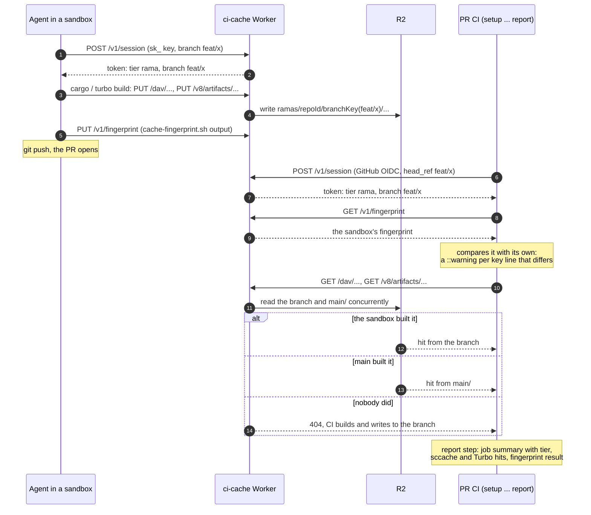
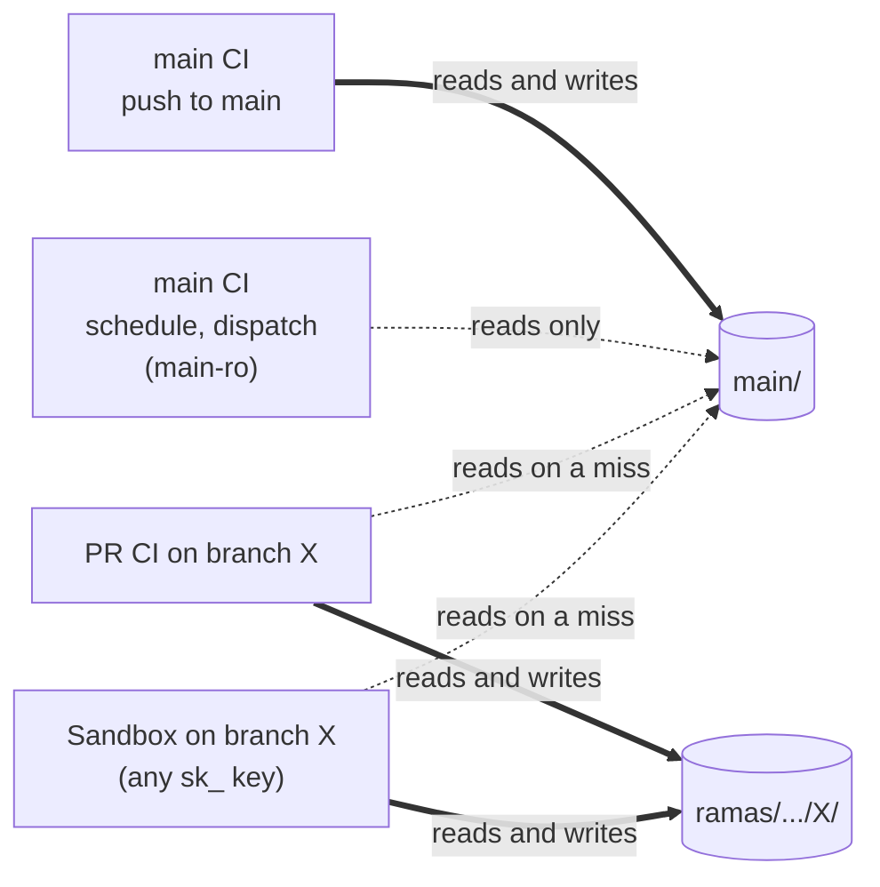

# ci-cache

A remote build cache for GitHub Actions and for coding agents, on your own Cloudflare
account. One Worker stores the **Turbo** cache (Remote Cache API v8) and the **sccache**
cache (WebDAV backend, for Rust) per repository in R2. A `main/` tier is written only by CI
on `main`; each branch has its own tier, written by that branch's CI and, optionally, by
the sandbox an agent builds it in.

- **CI first.** A pinned composite action wires a job: PR runs reuse what `main` built,
  and later runs of a branch reuse what its earlier runs built.
- **Agents' sandboxes, if you use them.** An agent building in a sandbox (any machine that
  can run a bash script with a key; [Boat](https://boat.dev) is the provider this repo is
  tested with) warms its own PR's CI. Nothing an agent or a PR writes can reach `main/`.
- **Yours.** It runs on your account, with your bucket and your keys. There is no
  dashboard: metrics come out of a JSON API documented in [`openapi.yaml`](openapi.yaml)
  (OpenAPI 3.1), so any frontend can use it ([why](#why-there-is-no-dashboard)).

## Quickstart (CI only)

Most adopters start here, and sandboxes can come later. You need a Cloudflare account with
R2 enabled and a workers.dev subdomain: new to Cloudflare? Read
[Before you start: Cloudflare](#before-you-start-cloudflare) first.

1. **Deploy the Worker** (one R2 bucket, two lifecycle rules, a few secrets) from a clone of
   this repo, with node and pnpm:

   ```sh
   pnpm install && pnpm wrangler login
   bash scripts/bootstrap.sh --allowed-owners <your-user-or-org> --dry-run   # read the plan
   bash scripts/bootstrap.sh --allowed-owners <your-user-or-org> [--location weur]
   ```

   It checks the account first (R2 enabled, a workers.dev subdomain) and prints the Worker
   name (pass `--name <it>` on reruns) and URL ([Deploying](#deploying-with-wrangler)).
   Save the URL as the GitHub Actions **secret** `CI_CACHE_URL`:
   `gh secret set CI_CACHE_URL --repo <owner/repo>`.
2. **CI.** Give the job `id-token: write` and add the action early in the job:

   ```yaml
   jobs:
     build:
       runs-on: ubuntu-latest
       permissions:
         contents: read
         id-token: write           # for the GitHub OIDC token
       steps:
         - uses: actions/checkout@v5
         - id: cache
           continue-on-error: true # a cache problem is a slower run, never a red one
           uses: OmarAlex24/ci-cache/setup@<sha>
           with:
             url: ${{ secrets.CI_CACHE_URL }}   # a secret: GitHub masks it in logs
         - run: pnpm turbo run build   # and/or cargo build: both now go through the Worker
           working-directory: ${{ steps.cache.outputs.workdir || github.workspace }}
         - if: always()                # last step: hits, misses and the fingerprint check
           continue-on-error: true
           uses: OmarAlex24/ci-cache/report@<sha>
   ```
3. **Check it hits.** The setup step logs `ci-cache: session <tier>`. Run the job twice: the
   report step's table in the job summary shows the sccache hit rate and the Turbo tasks
   from cache. The first `main` run after onboarding is cold; judge from the second.

## What to expect

From the first rollout ([case study](skill/ci-cache/references/case-study.md)): a Rust
workspace of 12 crates plus a browser extension and two Docker images, in one GitHub
Actions job on 8 vCPU. Only what the cache caused:

| | Result |
| --- | --- |
| First run after onboarding (cold: it fills `main/`) | 16 min 27 s, 1 sccache hit and 1,853 misses: slower than before, once |
| A warm run (sccache from `main/`, no `target/` restored) | 98 % sccache hits; the job took ~8 min |
| `main`, warm | 99.84 % Rust hits |
| A PR's CI after the agent built the branch in its sandbox | reused 96 % of the sandbox's objects (1,302 of 1,355) |

The same rollout also cut its `docker` task from 406–485 s to 23 s, but that came from
BuildKit's `type=gha` cache, not from ci-cache. And the job's median went from 12.4 min to
~10 min with other changes in between (nextest, the Docker cache), so not all of it is the
cache.

To measure your own repo: the report step puts each run's hit rates and time saved in the
job summary, and `scripts/job-durations.sh --compare <date or commit>` prints the median
first-attempt job duration before and after you enabled ci-cache, as a markdown table
([Measuring the gain](#measuring-the-gain)).

## Add sandboxes (optional)

Once CI hits, an agent's sandbox can share its branch's tier, so the agent's build warms its
PR's CI:

1. Mint a sandbox key, add its hash to the `SANDBOX_KEYS` secret and put the key in the
   sandbox as `CI_CACHE_SANDBOX_KEY`, next to `CI_CACHE_URL` ([Keys](#secrets-wrangler-secret-put)).
2. Install the client in the sandbox with one pinned, SHA-256-checked line, and before
   building run `bash ~/.ci-cache/ci-cache-env.sh && source ~/.ci-cache.env`
   ([Sandboxes](#sandboxes-scriptsci-cache-envsh)). Any provider works: Boat, a container,
   a VM or your laptop.
3. Check it: the PR's setup step compares the sandbox's cache fingerprint with CI's and
   warns about every difference (`ci-cache cache key mismatch`), and
   `GET /v1/stats/branches` shows how much of the sandbox's work CI reused ([Metrics](#metrics)).

Agents working on this repo, or connecting another repo to it, start at
[`AGENTS.md`](AGENTS.md). The [`skill/ci-cache`](skill/ci-cache) Claude Code skill automates
onboarding a repo (audit, keys, CI and sandbox wiring, measurement). Install it as a plugin
from this repo:

```
/plugin marketplace add OmarAlex24/ci-cache
/plugin install ci-cache@ci-cache
```

## Before you start: Cloudflare

ci-cache runs on your Cloudflare account. With none yet, once per account:

1. **Create an account** at [dash.cloudflare.com/sign-up](https://dash.cloudflare.com/sign-up).
   No domain is needed: the Worker gets a `workers.dev` URL.
2. **Enable R2.** In the dashboard, *Storage & databases → R2 → Overview*, complete the
   checkout that adds an R2 subscription ([R2: get started](https://developers.cloudflare.com/r2/get-started/)).
   Adding a subscription needs a payment method on file
   ([billing profile](https://developers.cloudflare.com/billing/get-started/create-billing-profile/)),
   even if usage stays within R2's free tier. Until then every R2 call fails with
   `code: 10042`, and `bootstrap.sh` stops and says so.
3. **Register a workers.dev subdomain** (`<subdomain>.workers.dev`) under *Workers & Pages*
   ([workers.dev](https://developers.cloudflare.com/workers/configuration/routing/workers-dev/)).
   Without one, `wrangler deploy` stops (and wrangler run by an AI agent registers one on its
   own, named after the project); `bootstrap.sh` checks first. Or skip it and serve the
   Worker on your own domain ([Custom domain](#custom-domain-optional)).
4. **Log wrangler in**: `pnpm wrangler login`, or `CLOUDFLARE_API_TOKEN`. With access to
   several accounts, set `CLOUDFLARE_ACCOUNT_ID`.

### Plans and limits that matter here

R2 and the Workers plan are billed separately. Prices as published in November 2026; check
the linked pages before relying on them.

| | Workers Free | Workers Paid |
| --- | --- | --- |
| Price | $0 | $5/month minimum per account |
| Worker requests | 100,000/day, reset at 00:00 UTC; past it, error 1027 | 10 million/month included, then $0.30/million |
| CPU time per request | 10 ms | 30 s by default |

Sources: [Workers pricing](https://developers.cloudflare.com/workers/platform/pricing/),
[Workers limits](https://developers.cloudflare.com/workers/platform/limits/).

| R2 (Standard storage) | Free each month | Beyond the free tier |
| --- | --- | --- |
| Storage | 10 GB-month | $0.015/GB-month |
| Class A operations (writes: `PutObject`) | 1 million | $4.50/million |
| Class B operations (reads: `GetObject`, `HeadObject`) | 10 million | $0.36/million |
| Egress | free | free |

Source: [R2 pricing](https://developers.cloudflare.com/r2/pricing/). `DeleteObject` is
free; the page doesn't say how lifecycle expirations are counted.

- **Request body: 100 MB** on the Free and Pro plans (the zone's plan, not the Workers
  plan), which caps one cache object ([Limits](#limits)).
- **Analytics Engine** (the `/v1/stats` metrics) is not billed at the moment; Workers Free
  includes 100,000 data points written and 10,000 read queries a day
  ([pricing](https://developers.cloudflare.com/analytics/analytics-engine/pricing/)).
- The Worker's CPU work per request is a token check plus routing, and bodies stream to and
  from R2. It should fit Workers Free's 10 ms, but that hasn't been measured; this repo's
  instance runs on Workers Paid.

### What it costs, roughly

Each cache request (a GET or PUT of one object) is one Worker request. A write is one
Class A operation. A read is one Class B operation on the `main` tier and two on a branch
(its own prefix and `main/`, read concurrently). Lifecycle rules keep storage bounded:
branches expire after 7 days and `main/` after 30.

From the first rollout ([case study](skill/ci-cache/references/case-study.md)), a Rust
workspace whose full build is ~1,850 sccache objects:

| One full build | Worker requests | Class A | Class B |
| --- | ---: | ---: | ---: |
| Cold (everything misses and is written) | ~3,700 | ~1,850 | ≤ ~3,700 |
| Warm (everything hits) | ~1,850 | 0 | ≤ ~3,700 |

So Workers Free's 100,000 requests a day cover about 25 cold or 50 warm full builds of that
workspace, and R2's free million Class A operations about 540 cold builds a month. Past the
free tiers, a million writes cost $4.50 in R2, a million reads $0.36 to $0.72, and a million
Worker requests $0.30 on Workers Paid. Measure your own numbers with `/v1/stats` and the R2
metrics in the dashboard.

## Supported technologies

Derived from the code and the e2e suites (`pnpm e2e`). "Tested (e2e)" means a real client
runs against `wrangler dev` in `scripts/e2e/`.

| Technology | Status | Notes |
| --- | --- | --- |
| Turbo (TS/JS monorepos) | Tested (e2e) | Remote Cache API v8 at `/v8/artifacts`; e2e with turbo 2.11.10 |
| Rust via sccache | Tested (e2e) | sccache 0.19.0, WebDAV at `/dav/`; e2e with `cargo build` on a two-crate workspace. The action installs sccache by SHA-256 on Linux x86_64 and aarch64 (both pinned); the e2e runs that install in Docker (ubuntu:24.04) on the host's architecture only |
| C/C++ via sccache | Should work, untested | Nothing in `/dav/` is Rust-specific. But `sccache: auto` only detects a `Cargo.toml` and the action only exports `RUSTC_WRAPPER`: set `sccache: "true"` and your own launcher (`CMAKE_C_COMPILER_LAUNCHER=sccache`, `CC="sccache gcc"`, …) |
| Docker / BuildKit layers | Not served by ci-cache | The skill recommends BuildKit `type=gha` (the Actions cache); ci-cache has no Docker credentials or registry API |
| Nx, Bazel, Gradle | Not served by ci-cache | Not supported: their remote cache protocols are not implemented ([adding support](#adding-support-for-your-stack)) |
| GitHub Actions | Tested (e2e) | Sessions from GitHub OIDC. `setup/setup.sh` is tested with a fake OIDC endpoint (the real one only exists inside Actions). Linux runners; the sccache install and `mount-workdir` are Linux-only (`mount-workdir: auto` skips the mount elsewhere), so a macOS runner can use Turbo only (`sccache: "false"`, should work, untested) |
| Sandboxes (any provider) | Tested (e2e) | `scripts/ci-cache-env.sh` with an `sk_` key against `wrangler dev`, in bash, zsh and dash; the installer on Ubuntu (Docker). Boat is the provider used in production; any machine that can run a bash script with an `sk_` key works the same way |
| Other CI providers (GitLab, CircleCI, Buildkite, …) | Not served by ci-cache | Not supported: only GitHub's OIDC issuer is accepted. An `sk_` key would work technically, but always gets the branch tier, so it could never fill `main/` |

### Package managers

ci-cache caches **task and compile outputs, not installs**: it never sees `node_modules`, a
pnpm store or `~/.cargo/registry`. Package managers matter only through the tool on top:

- **Through Turbo**: npm is tested (the e2e fixture is an npm workspace, `npm@10.9.2`).
  pnpm, yarn and bun should work, untested: Turbo hashes their lockfiles and ci-cache only
  stores the resulting artifacts. This repo itself uses pnpm for its own development.
- **Through sccache**: cargo is tested.
- Install caches stay where they are (`setup-node`'s cache, `Swatinem/rust-cache` for
  `~/.cargo`). Under `mount-workdir` pnpm can't hard-link from a store restored on the other
  side of the bind mount (EXDEV); `skill/ci-cache/references/turbo.md` has the options.

## Architecture


Every request without a valid credential counts against a per-IP rate limit; valid tokens
never do ([Rate limit](#rate-limit-on-bad-credentials)). Each cache request only verifies the
session token's HMAC signature: no database, no R2 keys in the Worker (it uses the `CACHE`
binding).

### A pull request, end to end



- `repoId` is the numeric GitHub repo id (it doesn't change on a rename).
- `branchKey` is the first 16 hex characters of `sha256(branch name)`.
- The tier comes first in the key, so expiry is **2 R2 rules for every repo**.
- The branch tier's wire value is `rama` and its R2 prefix is `ramas/` (with the lifecycle
  rule `ramas-7d`). These are fixed identifiers of the API and the bucket layout; renaming
  them would orphan existing objects and break clients.

## Tiers, and why they prevent poisoning

The client **never picks its tier**: it follows from who the client is.



Nothing on a branch can write to `main/`: only a push to main (an OIDC token signed by
GitHub) does.

| Identity | Tier | Reads | Writes |
| --- | --- | --- | --- |
| OIDC, an event in `MAIN_WRITE_EVENTS` (default `push`) on a ref in `MAIN_REFS` | `main` | `main/` | `main/` |
| OIDC with `head_ref` (pull_request, pull_request_target) | `rama` (branch) = `head_ref` | its branch, then `main/` | its branch |
| OIDC, another event on a main ref (schedule, workflow_dispatch...) | `main-ro` | `main/` | nothing (403) |
| OIDC on any other ref (push to a branch, tags) | `rama` (branch) = the ref name | its branch, then `main/` | its branch |
| Sandbox key `sk_...` | **always** `rama` (branch), even if the branch is named `main`; only on its `branches` patterns, if the key has them | its branch, then `main/` | its branch |

Rules are evaluated in that order: `head_ref` is checked before "main ref" because
`pull_request_target` carries `ref = refs/heads/main` (the base branch) and must land in the
branch tier.

**Why there is no poisoning:** the only thing `main` CI reads is `main/`, and only `main`
CI itself (a push, with an OIDC token signed by GitHub) writes to `main/`. If an agent in a
sandbox produces a bad artifact — through a bug, a different environment or on purpose — it
stays in `ramas/<repoId>/<branchKey>/` and at most that same branch's CI reuses it. It never
reaches `main/`, so neither `main` nor any other branch ever reuses it. A stolen sandbox key
can only write to branches, which expire in 7 days.

**Binding a key to branches.** By default a sandbox key can open a session for any branch of
its repo, so a sandbox could write into another PR's tier. Give its `SANDBOX_KEYS` entry
`"branches": ["agent/*", "fix/**"]` and the Worker answers 403 for any other branch: `*`
matches within one path segment (not `/`), `**` across them, everything else is literal. The
field is optional (absent = any branch); present, it holds 1 to 32 patterns, and a malformed
one makes `/v1/session` answer the generic 500 `misconfigured` for every key, like any other
malformed entry. The 403 is not a bad credential, so it never counts against the per-IP rate
limit. `mint-sandbox-key.sh --branches 'agent/*'` and `new-key.mjs --branches` write it.

## Endpoints

Full detail in [`openapi.yaml`](openapi.yaml).

| Endpoint | Credential | What it does |
| --- | --- | --- |
| `GET /health` | none | liveness check |
| `POST /v1/session` | OIDC or `sk_...` | issues the session token |
| `GET /v8/artifacts/status` | session | `{"status":"enabled"}` |
| `GET`/`HEAD`/`PUT /v8/artifacts/{hash}` | session | Turbo artifacts |
| `POST /v8/artifacts` | session | batch lookup |
| `POST /v8/artifacts/events` | session | turbo events (validated and dropped) |
| `GET`/`PUT`/`PROPFIND /dav/...` | session | WebDAV for sccache |
| `PUT`/`GET /v1/fingerprint` | session | stores the session's cache fingerprint / returns the one to compare against ([Fingerprints](#sandbox-vs-ci-fingerprints)) |
| `GET /v1/stats?repo=&range=` | `rk_...` | hits, misses, bytes, time saved, by tier, kind and protocol |
| `GET /v1/stats/branches?repo=&range=` | `rk_...` | reuse per branch and `reuseAlert` |
| `GET /v1/stats/repos?range=` | `rk_...` | the repos with traffic: name, totals, `lastSeenAt` and how many branches have `reuseAlert` |

## sccache (WebDAV)

Tested with **sccache 0.19.0** (OpenDAL's `webdav` backend) against `wrangler dev`. With
`SCCACHE_WEBDAV_ENDPOINT=https://<your-worker>/dav` and
`SCCACHE_WEBDAV_TOKEN=<session token>`, sccache only uses these verbs, and they are the only
ones the Worker implements:

| Verb | Path | When |
| --- | --- | --- |
| `GET` | `/dav/.sccache_check` | at server start, to check reads |
| `PROPFIND` (`Depth: 0`) | `/dav/` and `/dav/<a>/<b>/<c>/` | before each write, to know whether the parent directory exists; requires `getlastmodified` in the response |
| `PUT` | `/dav/.sccache_check` | at start, to check writes (a 403 leaves sccache read-only) |
| `GET` | `/dav/<a>/<b>/<c>/<hash>` | look up a compiled object |
| `PUT` | `/dav/<a>/<b>/<c>/<hash>` | store a compiled object |

`MKCOL` only shows up if `PROPFIND` says the directory doesn't exist; since R2 has no
directories, the Worker answers that they all exist and sccache never sends it. With
`SCCACHE_WEBDAV_DISABLE_CREATE_DIR=true` (the action and `ci-cache-env.sh` export it)
sccache doesn't send the `PROPFIND` either: each write is a single `PUT`. Any other verb
gets 405, and `PROPFIND` with a `Depth` other than 0 gets 403 (there are no listings). If
the endpoint ends in `/`, sccache sends `/dav//...`; the Worker tolerates it.

For sccache to hit between sandbox and CI, the checkout path, the toolchain and the flags
must match (see `scripts/cache-fingerprint.sh`), and `CARGO_INCREMENTAL=0` (sccache doesn't
cache incremental compilations). The action checks this on its own:
[Sandbox vs CI fingerprints](#sandbox-vs-ci-fingerprints).

## Sandbox vs CI fingerprints

If a sandbox and its branch's CI compile with different keys (another `RUSTFLAGS`,
toolchain, checkout path, user, `CARGO_HOME`…), CI misses everything the sandbox built.
ci-cache compares them automatically:

1. `ci-cache-env.sh`, after getting its session, runs `cache-fingerprint.sh` in the
   checkout with the exports loaded and uploads the output (`PUT /v1/fingerprint`). If that
   fails it prints a warning and goes on; `CI_CACHE_FINGERPRINT=false` skips it.
2. The setup action, after the session (and after `mount-workdir`, so with the real
   path), generates CI's fingerprint, uploads it (not on `main-ro`) and, on the branch tier,
   downloads the sandbox's for the same branch (`GET /v1/fingerprint`) and compares them
   with `scripts/fingerprint-diff.sh`.
3. Each line that enters the cache keys (class `KEY`) and differs becomes
   `::warning title=ci-cache cache key mismatch::RUSTFLAGS: sandbox=-D warnings ci=(missing)`
   plus a table in the job summary, one per item (unset and empty count as equal). Lines
   that don't change keys (vCPU, RAM, kernel) are never warnings; tool versions that may
   change another cache (node, turbo) go in a collapsed block of the summary, and so do the
   `KEY` lines when the job has no `RUSTC_WRAPPER` (sccache is off, so they can't cost a
   hit). No sandbox fingerprint for the branch: one log line, nothing else.

The step never fails the job, and its result is the action output `fingerprint-compare`
(`match`, `mismatch`, `none`, `skipped` or `error`). `fingerprint-compare: "false"` turns it
off. Fingerprints never carry secrets: `cache-fingerprint.sh` drops every variable whose
name or value mentions a token, key, secret, password, credential or auth, redacts `sk_`/`rk_`
values and `user:password@` in URLs, and `ci-cache-env.sh` refuses to upload one containing
its key or token. The sandbox's values only reach CI's log escaped. Fingerprints live under
the session's tier prefix (`ramas/<repoId>/<branchKey>/fingerprint/<kind>`,
`main/<repoId>/fingerprint/ci`), so the two lifecycle rules expire them, and they are not
counted in the metrics.

The comparison sees the job's environment when the action runs: a variable set only on a
later step (`env:` of the build step) is not in it. Put key variables in the job's `env:`.

## Metrics

Every cache request (a GET or PUT of an object; not HEADs, the batch lookup or
`.sccache_check`) writes a data point to Workers Analytics Engine:

| Column | Value |
| --- | --- |
| `index1` | repoId |
| `blob1` | repoId |
| `blob2` | tier: `main` \| `main-ro` \| `rama` (branch) |
| `blob3` | session kind: `ci` \| `sandbox` |
| `blob4` | protocol: `turbo` \| `sccache` |
| `blob5` | result: `hit` \| `hit-main` \| `miss` \| `write` |
| `blob6` | writer-kind of the object read (`ci` \| `sandbox`; empty on misses) |
| `blob7` | the session's branch |
| `blob8` | repo name (`owner/repo`); empty in data points from before `/v1/stats/repos` |
| `double1` | bytes |
| `double2` | the artifact's saved duration in ms (Turbo's `x-artifact-duration`; 0 for sccache) |

`hit-main` is a branch-tier (`rama`) hit served from `main/`. `/v1/stats*` queries the
Analytics Engine SQL API and sums `_sample_interval` (not `COUNT()`), so counts stay correct
if AE samples. AE keeps data for 3 months: the maximum range is `90d`.

`reuseAlert` in `/v1/stats/branches` is `true` when the sandbox wrote at least
`REUSE_ALERT_MIN_WRITES` objects on a branch and that branch's CI hit none of them: it
almost always means something enters the cache keys differently.

`/v1/stats/repos` lists the repos that had traffic in the range, without asking for their
ids: the name (from `blob8`; for old data points, from `SANDBOX_KEYS`; otherwise `null`), the
totals, the latest request (`lastSeenAt`) and how many branches have `reuseAlert`
(`reuseAlerts`). An `rk_` key with `repoIds` only sees those repos: the list is filtered, not
a 403. Each call makes two SQL API queries: a dashboard using it should cache it for a few
minutes.

### Server-Timing

Every response carries `Server-Timing` with the Worker's time, in ms: `session` (verifying
the token), `r2-own` and `r2-main` (each R2 read; a branch shows both because they are read
concurrently), `r2-put` (a write) and `total` (until the Worker hands over the response; the
R2 body keeps streaming afterwards). `curl -w '%{time_starttransfer}
%header{server-timing}'` separates the network from the Worker and from R2.

## Configuration

### Bindings (`wrangler.jsonc`)

| Binding | Type | What for |
| --- | --- | --- |
| `CACHE` | R2 (`ci-cache-weur` in `wrangler.jsonc`; `bootstrap.sh --bucket` deploys a copy with another name) | the cache; the Worker has no R2 keys |
| `METRICS` | Analytics Engine (dataset `ci_cache`) | one data point per request |
| `BAD_CREDENTIAL_LIMITER` | Rate Limiting (`ratelimits`, 30 per 60 s) | limits requests without a valid credential, per client IP ([Rate limit](#rate-limit-on-bad-credentials)) |

### Vars (`wrangler.jsonc`)

| Var | Default | What it is |
| --- | --- | --- |
| `CACHE_AUDIENCE` | `ci-cache` | `aud` that GitHub OIDC tokens must carry |
| `ALLOWED_OWNERS` | `your-github-user-or-org` (a placeholder: set it before deploying) | allowed GitHub owners, comma-separated (case-insensitive) |
| `MAIN_WRITE_EVENTS` | `push` | events that write to `main/` |
| `MAIN_REFS` | `refs/heads/main,refs/heads/master` | refs that count as main |
| `SESSION_TTL_SECONDS` | `21600` (6 h) | session token lifetime |
| `MAX_ARTIFACT_BYTES` | `104857600` (100 MB) | per-object cap on PUT |
| `METRICS_DATASET` | `ci_cache` | AE dataset; must match the `METRICS` binding |
| `REUSE_ALERT_MIN_WRITES` | `20` | `reuseAlert` threshold |
| `RATE_LIMIT_BAD_CREDENTIALS` | `true` | `false` turns off the rate limit on bad credentials without removing the binding |

### Rate limit on bad credentials

Requests that arrive **without a valid credential** count against a per-IP limit
(`cf-connecting-ip`): a missing or bad Bearer on `/v8/*` and `/dav/*`, a failed
`POST /v1/session` (401, or 403 for an owner outside `ALLOWED_OWNERS`), and a bad `rk_` key
on `/v1/stats*`. Past the limit, those failures answer `429 {"code":"rate_limited"}` with
`Retry-After: 60` instead of 401/403.

- **Valid credentials never touch the limiter.** It is only consulted after a credential
  has been rejected, so CI runners that share an IP with a misbehaving client keep working.
- **The number lives in the binding**, not in `vars`: `ratelimits[].simple` in
  [`wrangler.jsonc`](wrangler.jsonc) (`limit` failures per `period`, which must be 10 or
  60 s; default 30 per 60 s). Cloudflare counts per location, so it is approximate.
  `namespace_id` is any positive integer unique in your account (Workers sharing it share
  counters). `RATE_LIMIT_BAD_CREDENTIALS=false` turns it off.
- **Before the expensive work.** A bad `rk_` key costs a sha256 and is rejected before
  any Analytics Engine query. An OIDC token that is malformed, not RS256, from another
  issuer, for another audience or expired is rejected before the JWKS lookup. A
  well-formed forgery still costs one signature check (and counts as a failure).
- It fails open: no `cf-connecting-ip` (only local tools; Cloudflare always sets it) or a
  limiter error never blocks a request.

What it does **not** do: every request, limited or not, is still a Worker invocation that
you pay for. It stops brute force and expensive work (JWKS, SQL), not a flood. Real
volumetric protection is a WAF rate-limiting rule on a custom domain in front of the
Worker ([Custom domain](#custom-domain-optional)), plus not publishing the URL: keep it in the GitHub secret `CI_CACHE_URL` so it never
appears in public run logs ([why](#with-scriptsbootstrapsh-recommended)), and give the
Worker an unguessable name (`bootstrap.sh` does both).

### Secrets (`wrangler secret put`)

| Secret | What it is |
| --- | --- |
| `SESSION_SECRET` | HMAC key for session tokens, ≥ 32 random characters |
| `SANDBOX_KEYS` | JSON `{"<sha256 of the key>": {"repoId": 123, "repo": "owner/repo", "label": "...", "branches": ["agent/*"]}}` (`branches` optional: [binding a key to branches](#tiers-and-why-they-prevent-poisoning)) |
| `STATS_KEYS` | JSON `{"<sha256 of the key>": {"label": "...", "repoIds": [123]}}` (optional `repoIds` limits the repos) |
| `CF_ACCOUNT_ID` | Cloudflare account, for the Analytics Engine SQL API |
| `CF_API_TOKEN` | API token with the *Account Analytics: Read* permission |

Keys are generated with `node scripts/new-key.mjs sandbox <repoId> <owner/repo> [label]
[--branches <pattern,...>]` or
`node scripts/new-key.mjs stats <label> [repoId,...]`: it prints the key (only that once) and
the entry with its hash to merge into the secret. A repo can have several sandbox keys, one
per label (provider or machine pool); `skill/ci-cache/scripts/mint-sandbox-key.sh` keeps the
map and the keys without printing them. The Worker never stores plaintext keys.

## Deploying with wrangler

### With `scripts/bootstrap.sh` (recommended)

```sh
pnpm install
pnpm wrangler login
bash scripts/bootstrap.sh --allowed-owners <owner[,owner]> --dry-run   # prints the commands
bash scripts/bootstrap.sh --allowed-owners <owner[,owner]> [--location weur] [--with-stats] [--domain <host>]
```

`--dry-run` runs nothing and needs no wrangler and no login. The real run is
non-interactive and idempotent (rerun it with the same `--name` to finish or repair an
instance):

0. checks the account before changing anything: wrangler is logged in, R2 is enabled (else
   it stops with how to enable it) and, without `--domain`, the account has a workers.dev
   subdomain (`GET /accounts/<id>/workers/subdomain` with wrangler's own token, sent on
   stdin; it skips this check when it can't tell, for example with several accounts and no
   `CLOUDFLARE_ACCOUNT_ID`);
1. creates the R2 bucket if missing (`--bucket`, default `ci-cache`; `--location` is a
   location hint and only applies to a new bucket) and the two lifecycle rules
   (`ramas-7d` on `ramas/`, `main-30d` on `main/`), skipping the ones that exist;
2. deploys with `wrangler deploy --config <temporary copy> --name <name> --var
   ALLOWED_OWNERS:<owners>`. The temporary copy is `wrangler.jsonc` with `bucket_name` set to
   `--bucket` (and `namespace_id` to `--rate-limit-namespace`, and the custom domain of
   `--domain`, if given), written outside the repo: `wrangler.jsonc` is never edited, so `pnpm run deploy` keeps working as before;
3. sets `SESSION_SECRET` (`openssl rand -base64 48`, piped to `wrangler secret put`, never
   printed; kept if it already exists, since a new one would invalidate every session) and
   `SANDBOX_KEYS`/`STATS_KEYS` = `{}` if missing; with `--with-stats`, `CF_ACCOUNT_ID` and
   `CF_API_TOKEN` from the environment. If `wrangler secret list` fails, it stops before
   setting any of them, so a rerun never replaces an existing secret;
4. prints the Worker URL and the next steps.

`--name` defaults to `ci-cache-<6 random hex>` so the URL isn't guessable; the script prints
it, and you pass it on every rerun.

**Keep the URL out of public logs.** Store it as the GitHub Actions **secret**
`CI_CACHE_URL` (per repo or per org), not a variable, and use `${{ secrets.CI_CACHE_URL }}`
in workflows: GitHub masks secret values in every log line, so on a public repo the URL
never appears in run logs. The setup action also masks it (and its bare host, which curl
errors print) with `::add-mask::`, for URLs passed any other way. Dependabot runs only get
Dependabot secrets: without `CI_CACHE_URL` there, the setup step fails (and, with
`continue-on-error`, the run is just uncached).

### By hand

```sh
pnpm install
pnpm wrangler login

# 1. The bucket and the 2 lifecycle rules (they cover every repo).
#    The location hint goes near whoever compiles (Boat: OVH France and Poland → weur);
#    it can only be given when the bucket is created.
pnpm wrangler r2 bucket create ci-cache-weur --location weur
pnpm wrangler r2 bucket lifecycle add ci-cache-weur ramas-7d ramas/ --expire-days 7 --force
pnpm wrangler r2 bucket lifecycle add ci-cache-weur main-30d main/ --expire-days 30 --force
pnpm wrangler r2 bucket lifecycle list ci-cache-weur

# 2. Secrets
openssl rand -base64 48 | pnpm wrangler secret put SESSION_SECRET
pnpm wrangler secret put SANDBOX_KEYS      # paste the JSON of hashes
pnpm wrangler secret put STATS_KEYS
pnpm wrangler secret put CF_ACCOUNT_ID
pnpm wrangler secret put CF_API_TOKEN

# 3. Set ALLOWED_OWNERS (it ships as a placeholder) and check CACHE_AUDIENCE in
#    wrangler.jsonc (and the rate limit's namespace_id: unique in your account), then deploy
pnpm check
pnpm run deploy
```

The Analytics Engine dataset is created on the first `writeDataPoint`.

**Where the bucket lives matters more than anything else.** Every sccache or Turbo read is
at least one R2 operation (a branch reads its prefix and `main/` concurrently), and the
Worker runs in the Cloudflare colo closest to the client. Measured from a Boat sandbox in
Warsaw (colo WAW) with a bucket in WNAM, each R2 operation took ~180 ms; with the bucket in
WEUR, 50–120 ms (a branch miss, ~110 ms). Moving the Worker to the bucket (`placement`) is
worse: the body crosses the Atlantic and a 512 KB read went up to ~0.9 s.

R2 rules expire by **upload date**, not last use: a heavily used `main/` artifact still
disappears at 30 days, the next `main` CI misses it once and writes it again.

### Custom domain (optional)

By default the Worker answers at `https://<name>.<your-subdomain>.workers.dev`, which shows
your account's subdomain. To serve it on a hostname of your own instead, in a zone that is
active on Cloudflare in the same account:

```sh
bash scripts/bootstrap.sh --name <name> --allowed-owners <owner> --domain cache.example.com
```

The deploy config then gets `"routes": [{ "pattern": "cache.example.com", "custom_domain":
true }]`, `"workers_dev": false` and `"preview_urls": false`: Cloudflare creates the DNS
record and the certificate for the hostname, which must not already have a CNAME record
([Custom Domains](https://developers.cloudflare.com/workers/configuration/routing/custom-domains/)),
and the workers.dev URL stops answering
([workers.dev](https://developers.cloudflare.com/workers/configuration/routing/workers-dev/)).
Update `CI_CACHE_URL` everywhere to `https://cache.example.com`. Deploying by hand, put the
same three keys in `wrangler.jsonc`.

A custom domain is also where Cloudflare's WAF can sit in front of the Worker: a
[rate limiting rule](https://developers.cloudflare.com/waf/rate-limiting-rules/) on the
hostname throttles floods before they become Worker requests you pay for. The Free plan
allows one rule, counted per IP over 10 s; paid plans allow more rules and longer periods.
Remember that CI runners share IPs: keep the threshold well above what a busy CI run sends.

## Limits

- **100 MB per request**: a Worker's body limit (Free and Pro plans; Business 200 MB,
  Enterprise up to 5 GB; [limits](https://developers.cloudflare.com/workers/platform/limits/)). `MAX_ARTIFACT_BYTES` enforces it before touching R2 (413). A larger
  Turbo artifact isn't stored: turbo warns and goes on without the cache for that task.
- `PUT` requires `Content-Length` (411 if missing): the body streams to R2 without being
  loaded into memory, and R2 needs to know the length.
- Turbo hashes: 1 to 128 hex characters. sccache paths: `[A-Za-z0-9._-]` segments, at most
  512 characters.
- Batch lookup: 1000 hashes; JSON bodies up to 1 MB.
- On a 403, turbo turns off the remote cache **for the rest of the run**, so with a
  `main-ro` token the remote cache has to be read-only (`--cache=local:rw,remote:r` or
  `TURBO_CACHE`), otherwise later tasks stop reading `main/`.

## Integrating

### GitHub Actions CI: `setup/action.yml`

```yaml
permissions:
  contents: read
  id-token: write          # to request GitHub's OIDC token

jobs:
  build:
    runs-on: boat-large
    steps:
      - uses: actions/checkout@v5
      - id: cache
        uses: OmarAlex24/ci-cache/setup@<sha>
        with:
          url: ${{ secrets.CI_CACHE_URL }}   # a secret: GitHub masks it in logs
          # mount-workdir: auto (default): with Rust, builds at /home/user/<repo> like the sandboxes
          # workdir-path: /workspace/<repo>   # if your sandboxes clone somewhere else
      - working-directory: ${{ steps.cache.outputs.workdir || github.workspace }}
        run: |
          pnpm turbo run build
          cargo build --locked
      - if: always()
        continue-on-error: true
        uses: OmarAlex24/ci-cache/report@<sha>   # the same SHA as setup
```

The action requests the OIDC token (`ACTIONS_ID_TOKEN_REQUEST_URL`/`_TOKEN`) with the
audience `audience` (default `ci-cache`), calls `POST /v1/session`, masks the Worker's URL,
its host and the tokens (`::add-mask::`) and exports:

- `TURBO_API`, `TURBO_TOKEN`, `TURBO_TEAM` (= the repo name; turbo requires a team and the
  Worker ignores it). On the `main-ro` tier also `TURBO_CACHE=local:rw,remote:r`, because on
  a 403 turbo turns off the remote cache for the whole run.
- If there is Rust (`sccache: auto` looks for a `Cargo.toml`): installs sccache pinned by
  version and SHA-256 (0.19.0 by default, x86_64 and aarch64; another version requires
  `sccache-sha256`) and exports `RUSTC_WRAPPER=sccache`, `SCCACHE_WEBDAV_ENDPOINT=<url>/dav`,
  `SCCACHE_WEBDAV_TOKEN`, `SCCACHE_WEBDAV_DISABLE_CREATE_DIR=true` (no `PROPFIND` before each
  write) and `CARGO_INCREMENTAL=0`.
- `mount-workdir` mounts the checkout with `sudo mount --bind "$GITHUB_WORKSPACE"
  <workdir-path>` so that sccache keys match the sandboxes'. `workdir-path` is where your
  sandboxes clone the repo, `/home/user/<repo>` by default (Boat's path); set it to your
  provider's (an absolute path; changing it costs one cold run). The
  `workdir` output says where to build. `auto` (the default) mounts only when there is a
  `Cargo.toml` (the same detection as `sccache: auto`), on Linux, with passwordless sudo;
  otherwise, or if the target isn't empty or the mount fails, it logs why and builds in
  `GITHUB_WORKSPACE`. `"true"` mounts or fails the step; `"false"` never mounts. Build in
  `${{ steps.cache.outputs.workdir || github.workspace }}`.
- `TURBO_RUN_SUMMARY=true` (unless the job already sets it; `turbo-summary: "false"` to
  skip): turbo writes `.turbo/runs/*.json`, as with `--summarize`, so the report action can
  count Turbo cache hits without changing your command.
- Outputs: `tier`, `branch`, `expires-at`, `workdir`.
- Then it prints the cache fingerprint (`scripts/cache-fingerprint.sh`; `fingerprint: "false"`
  to skip it) and compares it with the sandbox's for the same branch, warning about every
  line that makes the cache miss (`fingerprint-compare: "false"` to skip it;
  [details](#sandbox-vs-ci-fingerprints)).
- Outputs also include `fingerprint-compare` (`match`, `mismatch`, `none`, `skipped`, `error`).
- At the end of the job, `report/` turns all of this into a table in the job summary
  ([Job summary](#job-summary-reportactionyml)).

### Job summary: `report/action.yml`

The last step of the job, after everything that builds:

```yaml
      - name: ci-cache report
        if: always()
        continue-on-error: true
        uses: OmarAlex24/ci-cache/report@<sha>   # the same SHA as setup
```

It writes one table to the job summary (`$GITHUB_STEP_SUMMARY`):

| Row | Source |
| --- | --- |
| Session | the tier and branch the setup action got (inputs `tier`/`branch` override them) |
| sccache | hits, misses and hit rate from `sccache --show-stats --stats-format json`, if sccache is on `PATH`, and an **estimate** of the compile time the hits saved (below) |
| Turbo | tasks from cache vs executed (and how many from the remote cache), and the task time saved: the sum of each task's `timeSaved` in the `.turbo/runs/*.json` this job wrote (how long the cached task took when it ran). The setup action exports `TURBO_RUN_SUMMARY=true` so no `--summarize` is needed |
| Fingerprint vs sandbox | the result of the setup action's comparison (`match`, the number of key lines that differ, no sandbox fingerprint, or skipped) |

The sccache estimate is hits × (this job's total compile time ÷ its compilations), minus the
time spent reading the hits, all from sccache's own counters. It assumes a hit would have
compiled as long as the job's average compilation, so it only appears with at least 10
compilations to average, and it is compile time summed over crates, not wall-clock: cargo
compiles crates in parallel. Both time-saved numbers are task or compile time, not minutes
off the job; the job's duration is what `scripts/job-durations.sh` measures.

It never fails the job and never prints sccache's cache location (it holds the Worker URL).
Composite actions have no post steps, which is why it is a separate action. sccache stats
need the server alive until then: set `SCCACHE_IDLE_TIMEOUT: "0"` in the job's `env:`.
Turbo summaries are looked for under `working-directory` (default the setup action's
`workdir`), up to 4 levels deep.

### Sandboxes: `scripts/ci-cache-env.sh`

Any machine an agent builds in can share its branch's tier: it needs bash, curl and git,
plus two values in its environment, `CI_CACHE_URL` and a sandbox key as
`CI_CACHE_SANDBOX_KEY`. A sandbox key always gets the branch tier (`rama`), even on `main`.

**Keys.** One key per repo and provider (or machine pool), so each rotates on its own:
`skill/ci-cache/scripts/mint-sandbox-key.sh <owner/repo> [label] [--rotate]` mints one per
label without printing it and merges its hash into the `SANDBOX_KEYS` map you upload
([Secrets](#secrets-wrangler-secret-put)). By hand: `node scripts/new-key.mjs sandbox
<repoId> <owner/repo> <label>`, where nobody reads the terminal.

**Install** (once per sandbox image or boot), pinned to a commit of this repo; every file is
checked against a SHA-256 embedded in the installer, and a mismatch installs nothing:

```sh
ref=<full commit SHA of OmarAlex24/ci-cache>
curl -fsSL "https://raw.githubusercontent.com/OmarAlex24/ci-cache/$ref/scripts/install-sandbox.sh" |
  bash -s -- --ref "$ref" --rust      # --rust also installs sccache (Linux x86_64/aarch64)
```

It puts `ci-cache-env.sh` and `cache-fingerprint.sh` in `~/.ci-cache/` (`--dir` for another
place; `CI_CACHE_SOURCE` for a fork's raw URL). From a checkout:
`bash scripts/install-sandbox.sh [--rust]`.

**Use**, in the repo, on the branch the agent works on:

```sh
bash ~/.ci-cache/ci-cache-env.sh && source ~/.ci-cache.env
```

The script takes the git branch (`CI_CACHE_BRANCH` for another one) and writes `TURBO_API`,
`TURBO_TOKEN`, `TURBO_TEAM`, `SCCACHE_WEBDAV_ENDPOINT`, `SCCACHE_WEBDAV_TOKEN`,
`SCCACHE_WEBDAV_DISABLE_CREATE_DIR=true`, `CARGO_INCREMENTAL=0` and, if sccache is installed,
`RUSTC_WRAPPER=sccache` to `~/.ci-cache.env` (mode 600; the key is never written there); it
restarts the sccache server so it picks up the new token. Then it uploads the checkout's
cache fingerprint (it needs `cache-fingerprint.sh` next to it, or
`CI_CACHE_FINGERPRINT_SCRIPT`) so the branch's CI can compare it; a failed upload is only a
warning.

**Renewal.** Sourcing `~/.ci-cache.env` renews the session by itself when the repo's branch
has changed (`git switch`) or the 6 h token has less than 15 minutes left: it reruns the
script, which needs `CI_CACHE_SANDBOX_KEY` still in the environment. If renewal fails it
says why, unsets the cache variables and returns 1, so a build never writes to the wrong
branch with a stale token. It works in bash, zsh and dash, under `set -u`, from any directory
(it checks the repo the session was made for); `CI_CACHE_NO_REFRESH=1` turns it off, and a branch pinned with
`CI_CACHE_BRANCH` is never switched. So put `source ~/.ci-cache.env` in each shell that
builds (or the agent's shell profile).

**The path.** sccache keys include the absolute path, so sandbox and CI must build at the
same one, with the same toolchain and flags: clone at `/home/user/<repo>` (the action's
default) or give the action your path as `workdir-path`.

**Recipes.** Boat: the skill's `connect-sandbox.sh <owner/repo> <env>` stores the key in a
Boat environment (`--label` for a labeled key) and installs the scripts. Any other shell:
export the two values from your provider's secret store, run the installer above in the
image or at boot, and clone at the path `workdir-path` names. A recipe for your provider is
welcome: [CONTRIBUTING.md](CONTRIBUTING.md) has the template.

## Measuring the gain

`scripts/job-durations.sh` reads first-attempt job durations from the jobs API (a rerun skips
work and lands on a warm machine, so it is not comparable). With `--compare` it splits the
runs at the date, or the commit, where you enabled ci-cache:

```sh
bash scripts/job-durations.sh <owner/repo> --workflow ci.yml --job build --compare <YYYY-MM-DD|commit>
```

```
| Job | Before | After | Change |
| --- | ---: | ---: | ---: |
| `build` | 12.3 min (n=20, 11.7 min–14.1 min) | 8.3 min (n=20, 8.0 min–9.9 min) | -32 % |
```

It is read-only, makes one API call per run (`--limit` per side, default 20) and refuses to
start when the hour's GitHub quota can't cover it. Fewer than 5 runs on a side get a `*`:
no verdict yet. Skip the cold first run on `main`, and compare like with like (the same
event, runner type and branch filter).

## Adding support for your stack

ci-cache speaks two protocols today. A third one (Go's `GOCACHEPROG`, Bazel's or Gradle's
HTTP cache, Nx, …) follows the same path:

1. **A route** in `src/<protocol>/routes.ts`, like [`src/turbo/routes.ts`](src/turbo/routes.ts)
   and [`src/dav/routes.ts`](src/dav/routes.ts): validate the path, read through
   `tierLayout(session, "<protocol>")` (own prefix, then `main/`), write only to the
   layout's `write` prefix (it is `null` on `main-ro`: answer 403). Guard it with
   `requireSession` (as both modules do) and mount it in [`src/app.ts`](src/app.ts).
2. **Prefixes** via [`src/storage/tiers.ts`](src/storage/tiers.ts): add the name to the
   `Protocol` union. Keys become `main/<repoId>/<protocol>/…` and
   `ramas/<repoId>/<branchKey>/<protocol>/…`, so the two existing lifecycle rules already
   cover it.
3. **Metrics** via `recordCacheEvent` in [`src/metrics/record.ts`](src/metrics/record.ts):
   the protocol lands in `blob4`. Add it to `PROTOCOLS` in `src/stats/queries.ts` so
   `/v1/stats` reports it under `byProtocol`.
4. **[`openapi.yaml`](openapi.yaml)**: the new paths, and the protocol in the `byProtocol`
   schema.
5. **Client env vars** in [`setup/setup.sh`](setup/setup.sh) (CI) and
   [`scripts/ci-cache-env.sh`](scripts/ci-cache-env.sh) (sandboxes), from the same session
   token. Never log the token.
6. **An e2e** in [`scripts/e2e/`](scripts/e2e) that runs the real client against
   `wrangler dev` (see `turbo.mjs`, `sccache.mjs`), plus a `package.json` script and a
   line in `pnpm e2e`.
7. **Tests** in `test/` (vitest in the Workers runtime): the tier rules, path validation
   and the metrics point.

**The cheap alternative**: point a tool that already speaks one of the existing protocols at
the existing endpoints. Anything that implements Turbo's Remote Cache API v8 can use
`/v8/artifacts` with the session token as a bearer token. A tool whose remote cache is plain
`GET`/`PUT` of objects over HTTP or WebDAV with a bearer token may work against `/dav/`, as
long as its paths fit the segment rules above and every `PUT` sends `Content-Length`; its
traffic is then counted as `sccache` in the metrics. None of these is tested.

Want a stack supported? [Open an issue](https://github.com/OmarAlex24/ci-cache/issues) with the tool, its remote-cache
protocol and a link to its docs.

## Why there is no dashboard

ci-cache is an engine, not a UI. Its metrics are a stable, documented JSON API: `/v1/stats`,
`/v1/stats/branches` and `/v1/stats/repos`, described in OpenAPI 3.1 and read with
read-only `rk_` keys that can be scoped to a set of repos. The Worker has no sessions,
cookies or login for people, and keeping it that way keeps its attack surface to tokens
only.

To see the numbers, fork it and add a UI, or build a dashboard on the API: generate a client
from [`openapi.yaml`](openapi.yaml) with any OpenAPI generator, and give it an `rk_` key.

## Development

```sh
pnpm install
cp .dev.vars.example .dev.vars      # set a SESSION_SECRET
pnpm dev                            # wrangler dev with local R2
pnpm check                          # typecheck + oxlint + vitest (Workers runtime, local R2)
pnpm e2e                            # real turbo 2.11.10, sccache, ci-cache-env.sh and setup.sh
pnpm lint:openapi                   # validates openapi.yaml (downloads @redocly/cli)
pnpm lint:sh                        # shellcheck of the client scripts
```

- `pnpm e2e:turbo` and `pnpm e2e:sccache` start their own `wrangler dev` with R2 in a
  temporary directory and sign session tokens with the `SESSION_SECRET` from `.dev.vars`
  (`scripts/mint-session.mjs`); there are no dev-only routes in the Worker. To use one that
  is already running: `CI_CACHE_URL=http://127.0.0.1:8787 pnpm e2e:turbo`.
- `pnpm e2e:sandbox` tests `ci-cache-env.sh` with a sandbox key generated on the fly
  (passed to `wrangler dev` with `--var SANDBOX_KEYS`). `pnpm e2e:setup` tests
  `setup/setup.sh` with a server that fakes GitHub's OIDC and `/v1/session` (the real OIDC
  only exists inside Actions) and, if Docker is available, runs the SHA-256-checked sccache
  install and the `mount --bind` on Ubuntu. `pnpm e2e:fingerprint` uploads a sandbox
  fingerprint with `ci-cache-env.sh` and runs the action's comparison step against it
  (different `RUSTFLAGS` → one warning; same values → none). `pnpm e2e:report` runs the
  report action's script on fixtures taken from real turbo and sccache output, and on a
  real turbo run with `TURBO_RUN_SUMMARY=true`. `pnpm e2e:durations` runs
  `scripts/job-durations.sh` against a fake `gh` (and checks the skill's copy is identical).
  `pnpm e2e:install` pipes `scripts/install-sandbox.sh` from a local server that serves this
  checkout by ref (a tampered file installs nothing) and, with Docker, installs sccache on
  Ubuntu with `--rust`. `pnpm e2e:mint` runs the skill's `mint-sandbox-key.sh` in a
  temporary key directory (labels, `--rotate`, no key ever printed).
- `pnpm e2e:bootstrap` runs `scripts/bootstrap.sh` against a fake `wrangler` that records
  every call, and a local fake of the subdomain API (no Cloudflare account is touched): dry
  run (also from a copy with no wrangler at all), a first run, an idempotent rerun,
  `--with-stats`, the preflight (R2 not enabled, no workers.dev subdomain), `--domain` and
  validation, checking that no secret or token reaches argv or the output; then the real
  wrangler bundles the generated configs with `deploy --dry-run`, offline.
- Analytics Engine can't be queried locally: the query sits behind the `AnalyticsClient`
  interface and the tests check the generated SQL and the shape of the responses.

## Security

- Every endpoint except `/health` requires a token; the three kinds (session, `sk_`, `rk_`)
  are not accepted outside their place.
- Requests without a valid credential are rate limited per IP; valid ones never are
  ([Rate limit](#rate-limit-on-bad-credentials)). A valid sandbox key on a branch outside
  its `branches` patterns gets a 403 that is not counted either.
- A sandbox key can be bound to branch patterns, so a leaked key or a confused agent can't
  write into other PRs' tiers ([Tiers](#tiers-and-why-they-prevent-poisoning)).
- Keys are stored as sha256 and compared in constant time against every entry; the session
  token's signature is verified with `crypto.subtle.verify`.
- Tokens are never logged; errors are generic JSON with no internal details.
- There are no listing endpoints (PROPFIND only with `Depth: 0`).

## Attribution

The Turbo API types (`src/turbo/spec.ts`) come from the spec in
[AdiRishi/turborepo-remote-cache-cloudflare](https://github.com/AdiRishi/turborepo-remote-cache-cloudflare),
MIT, © 2023 Adishwar Rishi.

## License

ci-cache is distributed under the Apache License, Version 2.0 (`Apache-2.0`). The full text
is in [`LICENSE`](LICENSE). `src/turbo/spec.ts` keeps its MIT notice ([Attribution](#attribution)).
